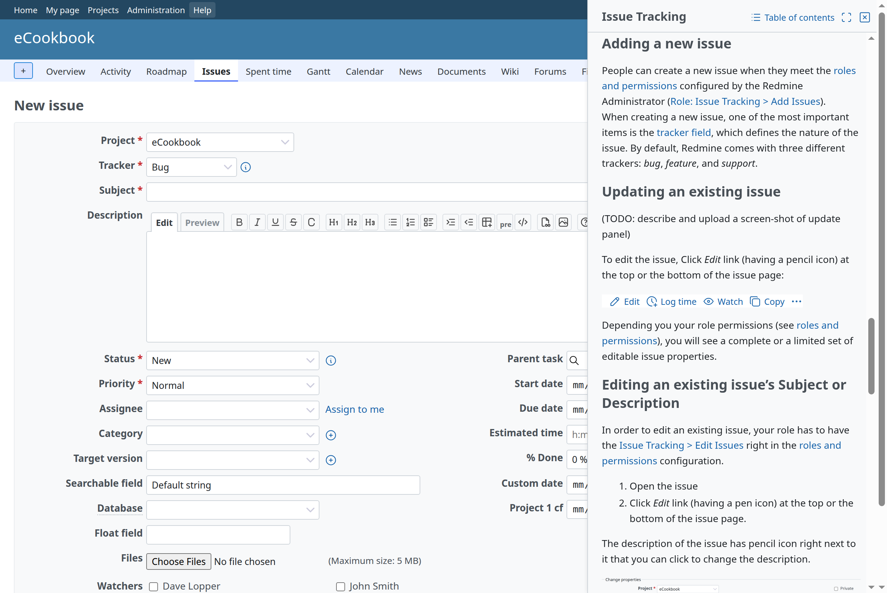
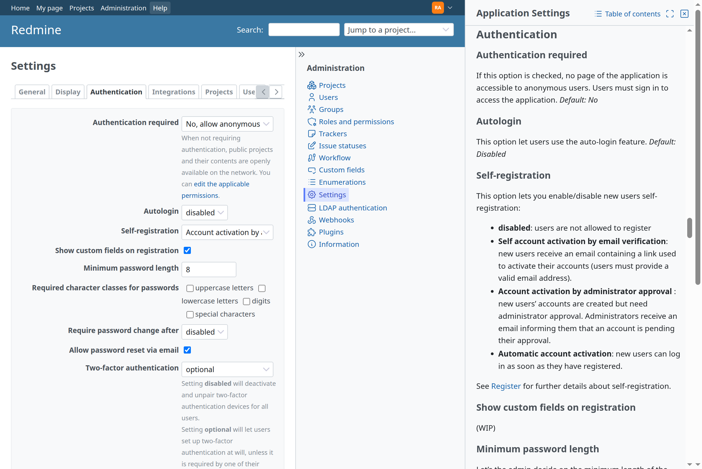

# Redmine Help

Redmine Help (`redmine_help`) turns the Help link in Redmine's header into help for the screen the user is on, in the user's language, shown inside Redmine.

- [Setup](setup.md): requirements, installation, the guide's content, configuration, tests
- [Mapping screens to topics](mapping.md): the map from a screen to its help topic
- [Adding help](extending.md): help of other plugins, and pages and support information of the operator

## Features

- **Help for the current screen, next to it.** The Help link opens a side panel with the topic mapped to the screen, at the screen's section (for example the issue list opens the guide's page on the issue list, Administration › Settings › Authentication opens the section on authentication). The page stays usable next to the panel, so a form can be filled in while reading. A screen without a topic shows the contents. See [Side panel](#side-panel).
- **In the user's language.** The help is shown in the user's language when it is translated, otherwise in English with a note. A switch in the sidebar shows the other languages.
- **Inside Redmine.** The panel and the help pages look like Redmine's sidebar and wiki pages: the text with its table of contents, a search over the help, and on the help pages the guide's sections in the sidebar.
- **The Redmine guide.** The guide of redmine.org, converted to Markdown and translated, comes from [redmine-guide](https://github.com/redmine-kit/redmine-guide), a separate repository and gem.
- **Help of other plugins.** A plugin adds its own topics, sections and screens by shipping a `help/` directory ([extending.md](extending.md#plugins)).
- **The operator's pages.** An operator adds pages (whom to contact, the support of a hosted service), a block shown on every page or on some topics, and replacements of topics, from a directory set with `REDMINE_HELP_EXTRA_PATH` ([extending.md](extending.md#the-operators-directory)).

## Screen

## Side panel

The Help link in the header opens and closes the panel at the end side of the window. The panel is not modal: the page makes room for it and stays usable. Close in the panel's header or Esc closes it too. On narrow windows (Redmine's responsive layout, up to 899 px wide) the panel covers the window.

### Content

The panel shows the topic mapped to the screen ([mapping.md](mapping.md)), scrolled to the mapped section. When a tab of the screen is switched (Administration › Settings, a project's settings), the panel moves to the tab's topic or section if the map has one for the tab.

Links between topics open in the panel, and Back returns to the previous topic. The search field at the top shows its results in the panel. Links to other pages open in a new window, so that the page next to the panel stays as it is. The operator's blocks ([extending.md](extending.md#the-operators-directory)) are shown as on the help pages.

When the panel is open and another screen is opened, the panel opens again with that screen's topic. The browser keeps whether the panel is open (`localStorage`).

### Help pages

In the panel's header, Table of contents opens the help's contents in a new window, and Open in full view opens the topic as a help page in a new window. Without JavaScript, the Help link opens the help page in a new tab, as before. The help pages are also the URLs to share.

### Accessibility

The Help link is a button with `aria-expanded` and `aria-controls`, and the panel is a complementary region labelled by its title. Opening the panel moves the focus to the title; closing it moves the focus back to the Help link.

### Strings

The panel uses Redmine's strings: Help (`label_help`), Back (`button_back`), Open in full view (`label_open_in_full_view`), Table of contents (`label_table_of_contents`) and Search (`label_search`). Close is the plugin's own string (`button_redmine_help_close`: Close, 閉じる), since Redmine's Close (`button_close`) is the action that closes a project (終了 in Japanese).

### Stylesheet

Redmine has no side panel. The panel's content is built from core's pieces: the sidebar's colors and border, `.contextual` with `.icon-only` links and core's icons (`sprite_icon`), `div.wiki` for the text and `dl#search-results`. Only what core cannot give is in `assets/stylesheets/help_panel.css`: the panel's frame and position (fixed at the end side, the full height, the header kept above the scrolling text), the margin that makes room for the panel next to the page and at the end of Redmine's sticky issue header, the full-window panel at Redmine's responsive breakpoint, and `[hidden]` inside the panel (core's `.icon` is `display: inline-flex`, which would show Back on the first page). The colors are core's variables (`--oc-gray-0`, `--oc-gray-4`), so themes that set them style the panel as they style the sidebar. The [Redmine Design Guide](https://redmine-kit.github.io/design-guide/side-panel.html) describes the pattern.

## Access

The help is open to whoever can see Redmine: signed-in users, and anonymous users when Redmine does not require login (Administration › Settings › Authentication › Authentication required).

## Sponsors

<Sponsors ids="keyselect"><a href="https://www.keyselect.co.jp/">KEY SELECT</a></Sponsors>

## License

Redmine Help is released under the GNU General Public License, version 2 or (at your option) any later version. See [LICENSE](../LICENSE). An unofficial Redmine plugin.
