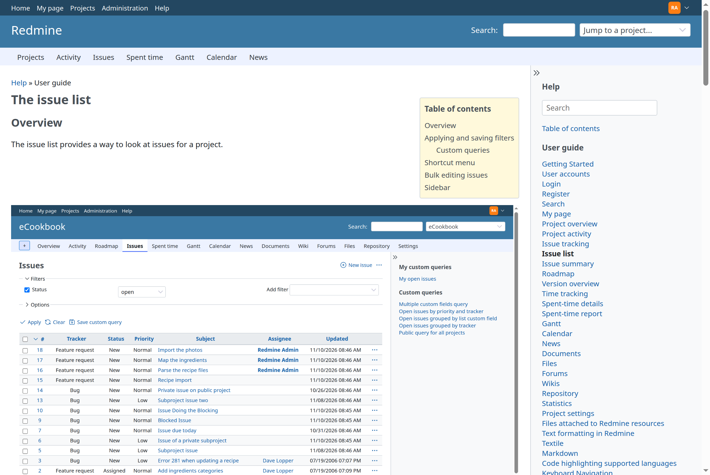

# Redmine Help

Redmine Help (`redmine_help`) turns the Help link in Redmine's header into help for the screen the user is on, in the user's language, shown inside Redmine.

- [Setup](setup.md): requirements, installation, the guide's content, configuration, tests
- [Mapping screens to topics](mapping.md): the map from a screen to its help topic
- [Adding help](extending.md): help of other plugins, and pages and support information of the operator

## Features

- **Help for the current screen.** The Help link opens the topic mapped to the screen (for example the issue list opens the guide's page on the issue list, Administration › Settings › Authentication opens the section on authentication). A screen without a topic opens the contents.
- **In the user's language.** The help is shown in the user's language when it is translated, otherwise in English with a note. A switch in the sidebar shows the other languages.
- **Inside Redmine.** The pages look like Redmine's wiki pages: the text with its table of contents, the guide's sections in the sidebar, and a search over the help.
- **The Redmine guide.** The guide of redmine.org, converted to Markdown and translated, comes from [redmine-guide](https://github.com/redmine-kit/redmine-guide), a separate repository and gem.
- **Help of other plugins.** A plugin adds its own topics, sections and screens by shipping a `help/` directory ([extending.md](extending.md#plugins)).
- **The operator's pages.** An operator adds pages (whom to contact, the support of a hosted service), a block shown on every page or on some topics, and replacements of topics, from a directory set with `REDMINE_HELP_EXTRA_PATH` ([extending.md](extending.md#the-operators-directory)).

## Screen

## Access

The help is open to whoever can see Redmine: signed-in users, and anonymous users when Redmine does not require login (Administration › Settings › Authentication › Authentication required).

## Sponsors

<Sponsors ids="keyselect"><a href="https://www.keyselect.co.jp/">KEY SELECT</a></Sponsors>

## License

Redmine Help is released under the GNU General Public License, version 2 or (at your option) any later version. See [LICENSE](../LICENSE). An unofficial Redmine plugin.
