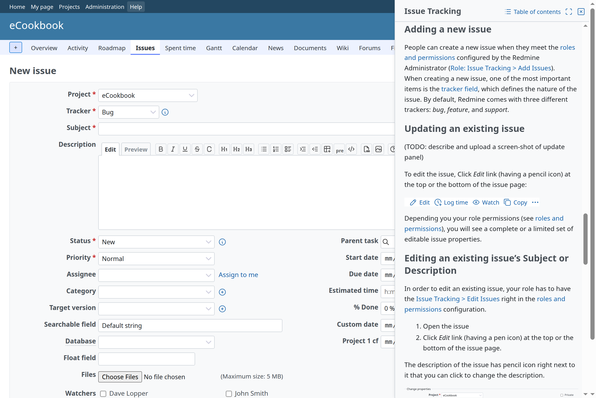
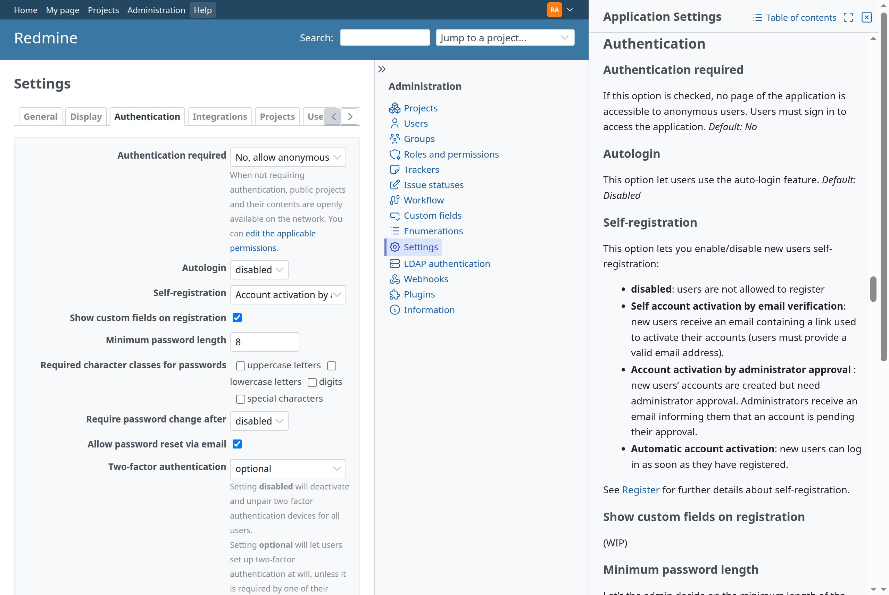
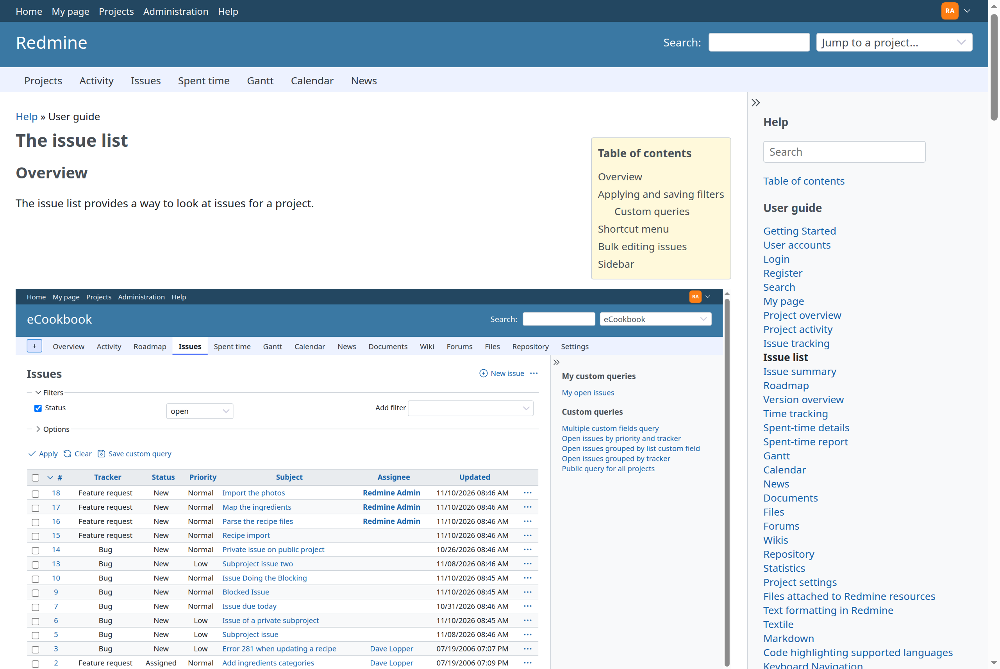

# Redmine Kit Help

Redmine Kit Help (`redmine_kit_help`) turns the Help link in Redmine's header into help for the screen the user is on, in the user's language, shown inside Redmine.

- [Setup](setup.md): requirements, installation, the guide's content, configuration, tests
- [Mapping screens to topics](mapping.md): the map from a screen to its help topic
- [Adding help](extending.md): help of other plugins, and pages and support information of the operator

## Features

- **Help for the current screen, next to it.** The Help link opens a side panel with the topic mapped to the screen, at the section that describes the screen (for example a new issue opens the section on adding a new issue, the issue list the guide's page on the issue list, Administration › Settings › Authentication the section on authentication). The panel is laid over the end side of the window; the rest of the page stays usable, so a form can be filled in while reading. A screen without a topic shows the contents. See [Side panel](#side-panel).
- **In the user's language.** The help is shown in the user's language when it is translated, otherwise in English with a note. A switch in the sidebar shows the other languages.
- **Inside Redmine.** The panel and the help pages look like Redmine's sidebar and wiki pages: the text with its table of contents, a search over the help, and on the help pages the guide's sections in the sidebar.
- **The Redmine guide.** The guide of redmine.org, converted to Markdown and translated, comes from [redmine-guide](https://github.com/redmine-kit/redmine-guide), a separate repository and gem.
- **Help of other plugins.** A plugin adds its own topics, sections and screens by shipping a `help/` directory ([extending.md](extending.md#plugins)).
- **The operator's pages.** An operator adds pages (whom to contact, the support of a hosted service), a block shown on every page or on some topics, and replacements of topics, from a directory set with `REDMINE_KIT_HELP_EXTRA_PATH` ([extending.md](extending.md#the-operators-directory)).

## Screen

## Side panel

The Help link in the header opens and closes the panel, laid over the end side of the window. The panel is not modal: there is no backdrop, and the part of the page it does not cover stays usable. Redmine's own dialogs (such as a new issue category) open above it. Close in the panel's header or Esc closes it too. On narrow windows (Redmine's responsive layout, up to 899 px wide) the panel covers the window.

### Content

The panel shows the topic mapped to the screen ([mapping.md](mapping.md)), scrolled to the mapped section. When a tab of the screen is switched (Administration › Settings, a project's settings), the panel moves to the tab's topic or section if the map has one for the tab.

Links between topics open in the panel, and Back returns to the previous topic. The search field at the top shows its results in the panel. Links to other pages open in a new window, so that the page next to the panel stays as it is. The operator's blocks ([extending.md](extending.md#the-operators-directory)) are shown as on the help pages.

When the panel is open and another screen is opened, the panel opens again with that screen's topic. The browser keeps whether the panel is open (`localStorage`).

### Help pages

In the panel's header, Table of contents opens the help's contents in a new window, and Open in full view opens the topic as a help page in a new window. Without JavaScript, the Help link opens the help page in a new tab, as before. The help pages are also the URLs to share.

### Accessibility

The Help link is a button with `aria-expanded` and `aria-controls`, and the panel is a complementary region labelled by its title. Opening the panel moves the focus to the title; closing it moves the focus back to the Help link.

### Strings

The panel uses Redmine's strings: Help (`label_help`), Back (`button_back`), Open in full view (`label_open_in_full_view`), Table of contents (`label_table_of_contents`) and Search (`label_search`). Close is the plugin's own string (`button_help_panel_close`: Close, 閉じる), since Redmine's Close (`button_close`) is the action that closes a project (終了 in Japanese). <!-- ja-ok: the Japanese strings are the subject -->

### Stylesheet

Redmine has no side panel. The panel's content is built from core's pieces: the sidebar's colors and padding, `.contextual` with `.icon-only` links and core's icons (`sprite_icon`), `div.wiki` for the text and `dl#search-results`. Only what core cannot give is in `assets/stylesheets/help_panel.css`: the panel's frame and position (laid over the end side, the full height, the header kept above the scrolling text), its edge (a border and a light shadow, as on Redmine's dropdowns), its stacking (above Redmine's sticky issue header and dropdowns, and under Redmine's modal dialogs while one is open), the full-window panel at Redmine's responsive breakpoint, and `[hidden]` inside the panel (core's `.icon` is `display: inline-flex`, which would show Back on the first page). The colors are core's variables (`--oc-gray-0`, `--oc-gray-4`, `--oc-black-rgb`), so themes that set them style the panel as they style the sidebar. The [Redmine Design Guide](https://redmine-kit.github.io/design-guide/side-panel.html) describes the pattern.

## The new UI

[Redmine Kit UI](https://github.com/redmine-kit/redmine_kit_ui)'s new UI draws its own screens. For it, the same help is
also JSON, and the plugin has a module of the new UI (`frontend/`, built into `assets/javascripts/kit/help.js` and
`assets/stylesheets/kit/help.css`) with the side panel (`HelpPanel`) and the help pages (`HelpPage`).

| Request | Answer |
| --- | --- |
| `GET /help.json` | the contents: the sections (the operator's first, then the guide's, then the plugins') with their topics |
| `GET /help/<topic>.json?anchor=` | the topic in the user's language (or English), as Markdown with its links rewritten to `/help/<topic>#<anchor>` and its images to `/help/assets/…`; its anchors; the anchor asked for, in the topic's language; the operator's blocks; its section |
| `GET /help/search.json?q=` | the topics with every word, each with a snippet |
| `GET /help/context.json?syntax=` | the topic of one of Redmine's help pages: `wiki` (help#show_wiki_syntax), the topic of the server's text formatting (Textile's, else Markdown's); `code` (help#show_code_highlighting), the code highlighting's languages |
| `GET /help/context.json?screen=&tab=` | the topic of a screen of the new UI (its name in Redmine Kit UI's route table, and its tab), at its anchor; `follow` when the tab has a topic of its own. `config/kit_screens.yml` gives each screen the Redmine screen it redesigns (`ProjectSettings: projects#settings`), so the same `map.yml` serves both UIs |

The JSON is open to the same users as the pages ([Access](#access)). `config/kit_ui.yml` declares the module to Redmine
Kit UI (its docs/plugins-kit.md):

- **The panel is the TopBar's Help.** The slot `topbar.panel` with `replaces: help` (the plugin replaces Redmine's top
  menu `:help` on the server too, which Redmine Kit UI checks) and `persist: true` (it stays open in the browser's tab
  across moves and reloads). The app opens it at the screen's topic, at the keyboard's topic (the `?` key) and at the
  text formatting's (an editor's help › all the syntax).
- **The panel's header** is the app's (Redmine Kit UI's `ExtensionPanelHeader`): its top row has the search field,
  filling the row, then Back (when there is a page before), Table of contents, Open in full view and Close; under it
  the title Help and the topic's title (or Search, Table of contents). On a phone's width the field narrows and the
  buttons stay in view. Opening the panel moves the focus to its title, not to the search, so that a phone's keyboard
  doesn't open. The slot says `actions: true`, so the top row is there before the module loads.
- **The help pages are screens:** `/help`, `/help/search` and `/help/*topic` (`HelpPage`), and Redmine's help pages,
  `/help/wiki_syntax[/detailed]` (`HelpWikiSyntax`) and `/help/code_highlighting` (`HelpCodeHighlighting`), which show
  the plugin's topic of each at Redmine's address. Without this plugin the new UI shows Redmine's own pages there.
- **Anonymous visitors** get the panel too (`anonymous: true`) unless Redmine requires a login, as they get the pages;
  the JSON answers them by the same rule ([Access](#access)). Like Redmine's own search, the search has no rate limit
  and no cache (the panel searches as the user types; the topics are read once and kept in memory): limit floods in
  front of Redmine (a reverse proxy, AWS WAF).

The module's source is built against `@redmine-kit/ui` and `@redmine-kit/plugin`, which aren't published yet: `bin/setup`
needs the ui checkout next to this repository. The built files are committed, so installing the plugin needs no
build.

## Access

The help is open to whoever can see Redmine: signed-in users, and anonymous users when Redmine does not require login (Administration › Settings › Authentication › Authentication required).

## Sponsors

<Sponsors ids="keyselect"><a href="https://www.keyselect.co.jp/">KEY SELECT</a></Sponsors>

## License

Redmine Kit Help is released under the GNU General Public License, version 2 or (at your option) any later version. See [LICENSE](../LICENSE). An unofficial Redmine plugin.
