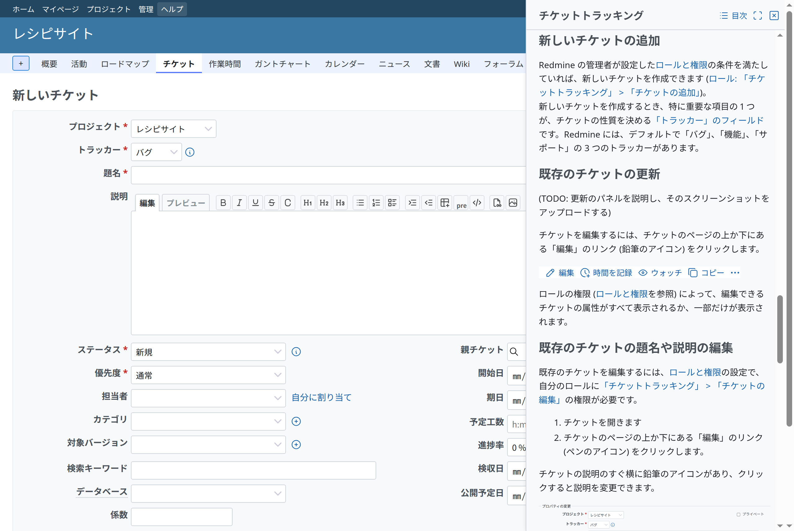
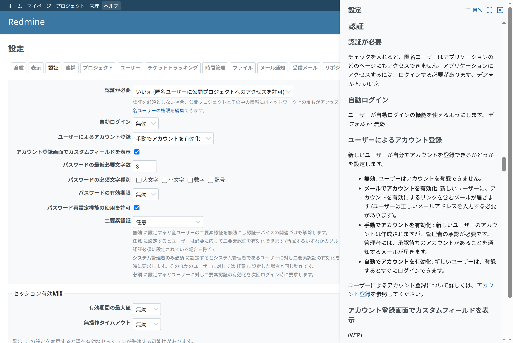
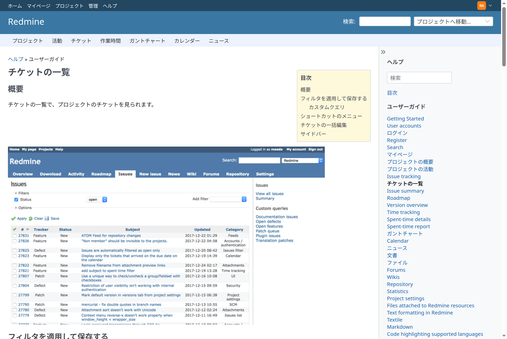

# Redmine Help

Redmine Help (`redmine_help`) は、Redmine のヘッダーの「ヘルプ」を、ユーザーがいま開いている画面のヘルプに変えるプラグインです。ヘルプはユーザーの言語で、Redmine の中に表示します。

- [準備](setup.md): 前提、インストール、ガイドの中身、設定、テスト
- [画面とトピックの対応](mapping.md): 画面からヘルプのトピックへの対応表
- [ヘルプを足す](extending.md): ほかのプラグインのヘルプ、運用者のページとサポート情報

## 機能

- **いま開いている画面のヘルプを横に表示:** 「ヘルプ」は、画面に対応付けたトピックをサイドパネルに開き、その画面を説明する節を表示します。たとえば、新しいチケットではチケットの追加の節を、チケットの一覧ではガイドのチケットの一覧のページを、「管理」›「設定」›「認証」では認証の節を開きます。サイドパネルはウィンドウの端に重ねて表示し、ほかの部分はそのまま操作できるので、ヘルプを読みながらフォームに入力できます。対応するトピックのない画面では、目次を表示します。[サイドパネル](#side-panel)を参照してください。
- **ユーザーの言語:** 翻訳があればユーザーの言語で、なければ英語で、その旨を添えて表示します。サイドバーで、ほかの言語に切り替えられます。
- **Redmine の中に表示:** サイドパネルとヘルプページは、Redmine のサイドバーと Wiki のページと同じ形です。本文と目次、ヘルプの中の検索があり、ヘルプページにはサイドバーにガイドの章があります。
- **Redmine のガイド:** redmine.org のガイドを Markdown にして翻訳したものです。別のリポジトリと gem の [redmine-guide](https://github.com/redmine-kit/redmine-guide) にあります。
- **ほかのプラグインのヘルプ:** プラグインは、`help/` のディレクトリを持つだけで、自分のトピック、章、画面を足せます ([extending.md](extending.md#plugins))。
- **運用者のページ:** `REDMINE_HELP_EXTRA_PATH` で指定したディレクトリから、ページ (社内の問い合わせ先、ホスティングのサービスのサポートなど)、すべてのページや一部のトピックに出す囲み、トピックの置き換えを足せます ([extending.md](extending.md#the-operators-directory))。

## 画面

## サイドパネル

ヘッダーの「ヘルプ」で、ウィンドウの端に重ねて表示するサイドパネルを開閉します。サイドパネルはモーダルではありません。背景を覆うことはなく、サイドパネルが覆っていない部分の画面はそのまま操作できます。Redmine のダイアログ (新しいカテゴリなど) は、サイドパネルの上に開きます。サイドパネルのヘッダーの「閉じる」か Esc キーでも閉じます。狭いウィンドウ (Redmine のレスポンシブレイアウト、幅 899 px まで) では、サイドパネルがウィンドウ全体を覆います。

### 内容

サイドパネルは、画面に対応付けたトピック ([mapping.md](mapping.md)) を、対応付けた節の位置で表示します。画面のタブ (「管理」›「設定」、プロジェクトの設定) を切り替えると、対応表にそのタブのキーがあれば、サイドパネルもそのタブのトピックや節に移ります。

トピック間のリンクはサイドパネルの中で開き、「戻る」で前のトピックに戻ります。上部の検索フィールドの結果も、サイドパネルに表示します。ほかのページへのリンクは新しいウィンドウで開き、サイドパネルの横の画面はそのまま残ります。運用者の囲み ([extending.md](extending.md#the-operators-directory)) は、ヘルプページと同じく表示します。

サイドパネルを開いたまま別の画面を開くと、サイドパネルはその画面のトピックで再び開きます。開いているかどうかは、ブラウザーに保存します (`localStorage`)。

### ヘルプページ

サイドパネルのヘッダーの「目次」は、ヘルプの目次を新しいウィンドウで開きます。「全画面で表示」は、トピックをヘルプページとして新しいウィンドウで開きます。JavaScript がないときは、これまでどおり「ヘルプ」がヘルプページを新しいタブで開きます。共有する URL もヘルプページの URL です。

### アクセシビリティ

「ヘルプ」は `aria-expanded` と `aria-controls` を持つボタンで、サイドパネルはタイトルをラベルにした complementary のランドマークです。サイドパネルを開くとフォーカスがタイトルに移り、閉じると「ヘルプ」に戻ります。

### 文言

サイドパネルは Redmine の文言を使います。「ヘルプ」(`label_help`)、「戻る」(`button_back`)、「全画面で表示」(`label_open_in_full_view`)、「目次」(`label_table_of_contents`)、「検索」(`label_search`) です。「閉じる」だけはプラグインの文言 (`button_redmine_help_close`: Close、閉じる) です。Redmine の `button_close` は、プロジェクトを終了する操作の文言 (日本語は「終了」) のためです。

### スタイルシート

Redmine にはサイドパネルがありません。サイドパネルの内容は、本体の部品で組み立てています。サイドバーの色と余白、`.contextual` と `.icon-only` のリンク、本体のアイコン (`sprite_icon`)、本文の `div.wiki`、`dl#search-results` です。本体にないものだけを `assets/stylesheets/help_panel.css` に書いています。サイドパネルの枠と位置 (ウィンドウの端に重ねて固定、高さいっぱい、本文をスクロールしてもヘッダーは残す)、境界 (Redmine のドロップダウンと同じ境界線と薄い影)、重なり順 (Redmine のチケットのスティッキーヘッダーやドロップダウンより上、Redmine のモーダルダイアログを開いている間はその下)、Redmine のレスポンシブレイアウトのブレークポイントでウィンドウ全体を覆う表示、サイドパネルの中の `[hidden]` (本体の `.icon` は `display: inline-flex` なので、そのままでは最初のページで「戻る」が表示されます) です。色は本体の CSS 変数 (`--oc-gray-0`、`--oc-gray-4`、`--oc-black-rgb`) なので、これらを設定するテーマは、サイドバーと同じくサイドパネルにも反映されます。パターンは [Redmine Design Guide](https://redmine-kit.github.io/design-guide/ja/side-panel.html) にあります。

## 使える人

ヘルプは、Redmine を見られる人なら誰でも開けます。ログインしたユーザーと、Redmine がログインを求めないとき (「管理」›「設定」›「認証」›「認証が必要」がオフ) は匿名のユーザーです。

## スポンサー

<Sponsors ids="keyselect"><a href="https://www.keyselect.co.jp/">KEY SELECT</a></Sponsors>

## ライセンス

Redmine Help は、GNU General Public License バージョン 2 またはそれ以降のバージョンで公開しています。[LICENSE](../../LICENSE) を参照してください。Redmine の非公式のプラグインです。
