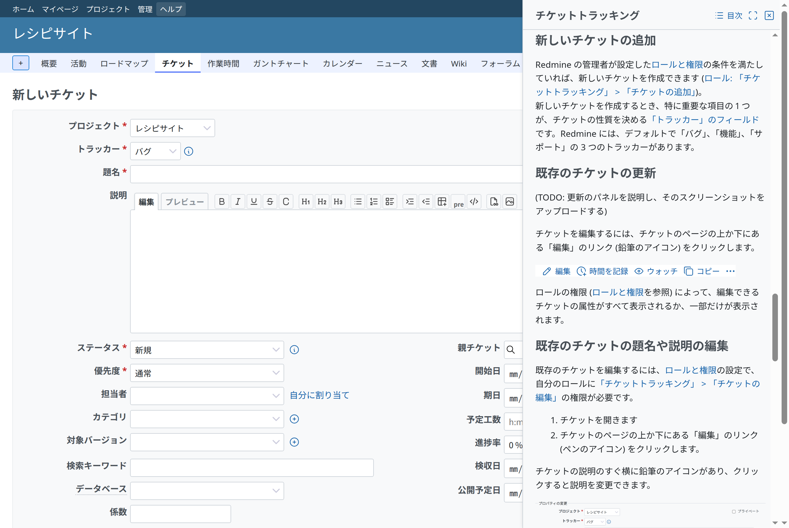
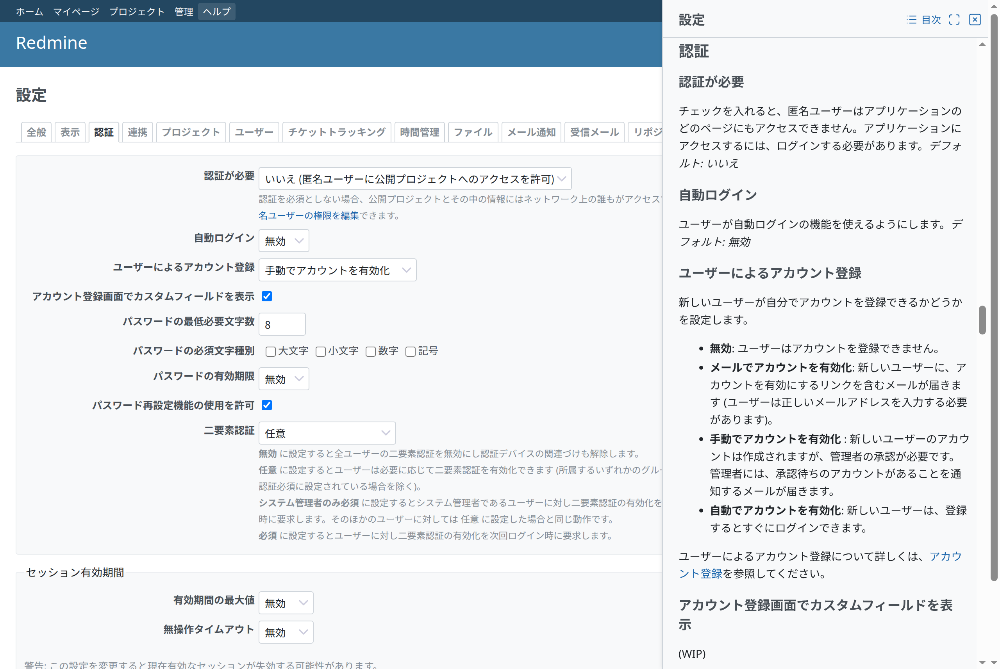
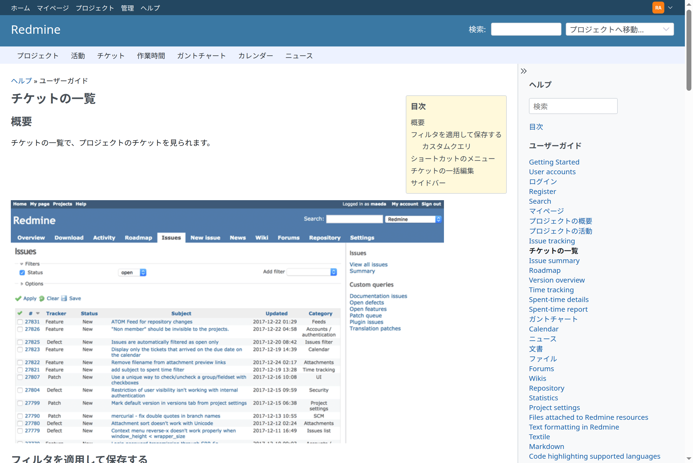

# Redmine Kit Help

Redmine Kit Help (`redmine_kit_help`) は、Redmine のヘッダーの「ヘルプ」を、ユーザーがいま開いている画面のヘルプに変えるプラグインです。ヘルプはユーザーの言語で、Redmine の中に表示します。

- [準備](setup.md): 前提、インストール、ガイドの中身、設定、テスト
- [画面とトピックの対応](mapping.md): 画面からヘルプのトピックへの対応表
- [ヘルプの追加](extending.md): ほかのプラグインのヘルプ、運用者のページとサポート情報

## 機能

- **いま開いている画面のヘルプを横に表示:** 「ヘルプ」は、画面に対応付けたトピックをサイドパネルに開き、その画面を説明する節を表示します。たとえば、新しいチケットではチケットの追加の節を、チケットの一覧ではガイドのチケットの一覧のページを、「管理」›「設定」›「認証」では認証の節を開きます。サイドパネルはウィンドウの端に重ねて表示し、ほかの部分はそのまま操作できるので、ヘルプを読みながらフォームに入力できます。対応するトピックのない画面では、目次を表示します。[サイドパネル](#side-panel)を参照してください。
- **ユーザーの言語:** 翻訳があればユーザーの言語で、なければ英語で、その旨を添えて表示します。サイドバーで、ほかの言語に切り替えられます。
- **Redmine の中に表示:** サイドパネルとヘルプページは、Redmine のサイドバーと Wiki のページと同じ形です。本文と目次、ヘルプの中の検索があり、ヘルプページにはサイドバーにガイドの章があります。
- **Redmine のガイド:** redmine.org のガイドを Markdown にして翻訳したものです。別のリポジトリと gem の [redmine-guide](https://github.com/redmine-kit/redmine-guide) にあります。
- **ほかのプラグインのヘルプ:** プラグインは、`help/` のディレクトリを持つだけで、自分のトピック、章、画面を追加できます ([extending.md](extending.md#plugins))。
- **運用者のページ:** `REDMINE_KIT_HELP_EXTRA_PATH` で指定したディレクトリから、ページ (社内の問い合わせ先、ホスティングのサービスのサポートなど)、すべてのページや一部のトピックに出す囲み、トピックの置き換えを追加できます ([extending.md](extending.md#the-operators-directory))。

## 画面

## サイドパネル

ヘッダーの「ヘルプ」で、ウィンドウの端に重ねて表示するサイドパネルを開閉します。サイドパネルはモーダルではありません。背景を覆うことはなく、サイドパネルが覆っていない部分の画面はそのまま操作できます。Redmine のダイアログ (新しいカテゴリなど) は、サイドパネルの上に開きます。サイドパネルのヘッダーの「閉じる」か Esc キーでも閉じます。狭いウィンドウ (Redmine のレスポンシブレイアウト、幅 899 px まで) では、サイドパネルがウィンドウ全体を覆います。

### 内容

サイドパネルは、画面に対応付けたトピック ([mapping.md](mapping.md)) を、対応付けた節の位置で表示します。画面のタブ (「管理」›「設定」、プロジェクトの設定) を切り替えると、対応表にそのタブのキーがあれば、サイドパネルもそのタブのトピックや節に移ります。

トピック間のリンクはサイドパネルの中で開き、「戻る」で前のトピックに戻ります。上部の検索フィールドの結果も、サイドパネルに表示します。ほかのページへのリンクは新しいウィンドウで開き、サイドパネルの横の画面はそのまま残ります。運用者の囲み ([extending.md](extending.md#the-operators-directory)) は、ヘルプページと同じく表示します。

サイドパネルを開いたまま別の画面を開くと、サイドパネルはその画面のトピックで再び開きます。開いているかどうかは、ブラウザーに保存します (`localStorage`)。

### ヘルプページ

サイドパネルのヘッダーの「目次」は、ヘルプの目次を新しいウィンドウで開きます。「全画面で表示」は、トピックをヘルプページとして新しいウィンドウで開きます。JavaScript がないときは、これまでどおり「ヘルプ」がヘルプページを新しいタブで開きます。共有する URL もヘルプページの URL です。

### アクセシビリティ

「ヘルプ」は `aria-expanded` と `aria-controls` を持つボタンで、サイドパネルはタイトルをラベルにした complementary のランドマークです。サイドパネルを開くとフォーカスがタイトルに移り、閉じると「ヘルプ」に戻ります。

### 文言

サイドパネルは Redmine の文言を使います。「ヘルプ」(`label_help`)、「戻る」(`button_back`)、「全画面で表示」(`label_open_in_full_view`)、「目次」(`label_table_of_contents`)、「検索」(`label_search`) です。「閉じる」だけはプラグインの文言 (`button_help_panel_close`: Close、閉じる) です。Redmine の `button_close` は、プロジェクトを終了する操作の文言 (日本語は「終了」) のためです。

### スタイルシート

Redmine にはサイドパネルがありません。サイドパネルの内容は、本体の部品で組み立てています。サイドバーの色と余白、`.contextual` と `.icon-only` のリンク、本体のアイコン (`sprite_icon`)、本文の `div.wiki`、`dl#search-results` です。本体にないものだけを `assets/stylesheets/help_panel.css` に書いています。サイドパネルの枠と位置 (ウィンドウの端に重ねて固定、高さいっぱい、本文をスクロールしてもヘッダーは残す)、境界 (Redmine のドロップダウンと同じ境界線と薄い影)、重なり順 (Redmine のチケットのスティッキーヘッダーやドロップダウンより上、Redmine のモーダルダイアログを開いている間はその下)、Redmine のレスポンシブレイアウトのブレークポイントでウィンドウ全体を覆う表示、サイドパネルの中の `[hidden]` (本体の `.icon` は `display: inline-flex` なので、そのままでは最初のページで「戻る」が表示されます) です。色は本体の CSS 変数 (`--oc-gray-0`、`--oc-gray-4`、`--oc-black-rgb`) なので、これらを設定するテーマは、サイドバーと同じくサイドパネルにも反映されます。パターンは [Redmine Design Guide](https://redmine-kit.github.io/design-guide/ja/side-panel.html) にあります。

## 新しい UI

[Redmine Kit UI](https://github.com/redmine-kit/redmine_kit_ui) の新しい UI は、自分の画面を描きます。そのために、同じ
ヘルプを JSON でも返します。また、プラグインは新しい UI のモジュール (`frontend/`。`assets/javascripts/kit/help.js` と
`assets/stylesheets/kit/help.css` にビルド) を持ち、サイドパネル (`HelpPanel`) とヘルプページ (`HelpPage`) があります。

| リクエスト | 応答 |
| --- | --- |
| `GET /help.json` | 目次: 章 (運用者のもの、ガイドのもの、プラグインのものの順) とそのトピック |
| `GET /help/<トピック>.json?anchor=` | ユーザーの言語 (なければ英語) のトピック。Markdown で、リンクを `/help/<トピック>#<アンカー>` に、画像を `/help/assets/…` に書き換えたもの。アンカーの一覧、指定したアンカー (トピックの言語のもの)、運用者の囲み、章 |
| `GET /help/search.json?q=` | すべての語を含むトピックと、その抜粋 |
| `GET /help/context.json?syntax=` | Redmine のヘルプのページのトピック: `wiki` (help#show_wiki_syntax) はサーバーのテキスト書式のトピック (Textile、それ以外は Markdown)、`code` (help#show_code_highlighting) はコードハイライトの言語 |
| `GET /help/context.json?screen=&tab=` | 新しい UI の画面 (Redmine Kit UI のルート表での名前とタブ) のトピックとアンカー。タブに専用のトピックがあれば `follow`。`config/kit_screens.yml` が各画面に、その画面が作り直した Redmine の画面 (`ProjectSettings: projects#settings`) を対応付けるので、同じ `map.yml` で両方の UI に対応します |

JSON を使えるユーザーは、ページと同じです ([アクセス](#access))。`config/kit_ui.yml` がモジュールを Redmine Kit UI に
宣言します (その docs/plugins-kit.md):

- **パネルは TopBar の「ヘルプ」です。** スロット `topbar.panel` に `replaces: help` (プラグインはサーバーでも Redmine の
  トップメニューの `:help` を置き換えており、Redmine Kit UI がそれを確認します) と `persist: true` (ブラウザーのタブの中で、
  移動やリロードの後も開いたまま) を付けます。アプリは画面のトピック、キーボード操作のトピック (`?` キー)、テキスト書式の
  トピック (エディターのヘルプ › すべての記法) で開きます。
- **ヘルプページは画面です:** `/help`、`/help/search`、`/help/*topic` (`HelpPage`) と、Redmine のヘルプのページ
  `/help/wiki_syntax[/detailed]` (`HelpWikiSyntax`)、`/help/code_highlighting` (`HelpCodeHighlighting`)。後の 2 つは
  Redmine のアドレスのまま、それぞれのプラグインのトピックを表示します。このプラグインがなければ、新しい UI はそこに
  Redmine 自身のページを表示します。
- **匿名の訪問者** にも、Redmine がログインを必須にしていなければ、ページと同じくパネルを出します (`anonymous: true`)。JSON も
  同じ規則で答えます ([アクセス](#access))。検索は IP アドレスごとに 1 分に 60 回までで (429。
  回数は Rails.cache に数えるので、共有のキャッシュならサーバーのプロセス間で共有されます)、答えはキャッシュします。

モジュールのソースは、まだ公開していない `@redmine-kit/ui` と `@redmine-kit/plugin` に対してビルドします。`bin/setup` には、
このリポジトリの隣に ui-mock のチェックアウトが必要です。ビルドしたファイルはコミットしてあるので、プラグインの
インストールにビルドは要りません。

## アクセス権限

ヘルプは、Redmine を見られる人なら誰でも開けます。ログインしたユーザーと、Redmine がログインを求めないとき (「管理」›「設定」›「認証」›「認証が必要」がオフ) は匿名のユーザーです。

## スポンサー

<Sponsors ids="keyselect"><a href="https://www.keyselect.co.jp/">KEY SELECT</a></Sponsors>

## ライセンス

Redmine Kit Help は、GNU General Public License バージョン 2 またはそれ以降のバージョンで公開しています。[LICENSE](../../LICENSE) を参照してください。Redmine の非公式のプラグインです。
